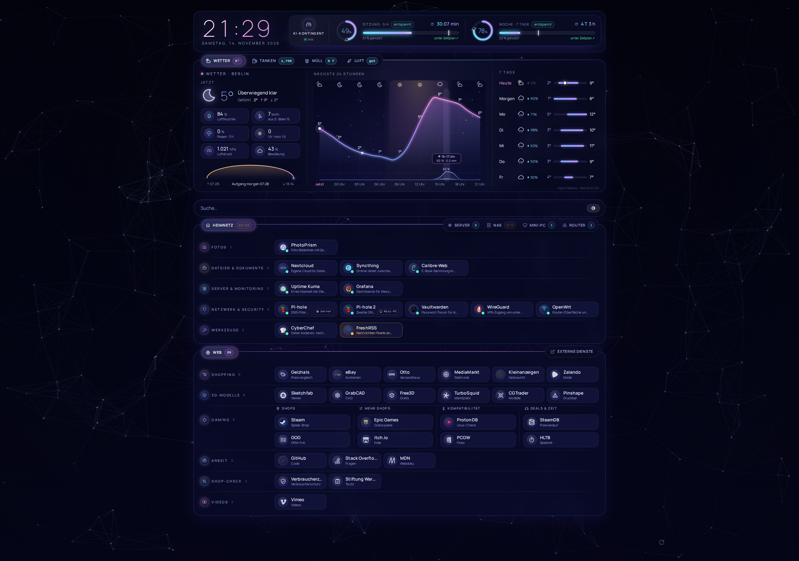
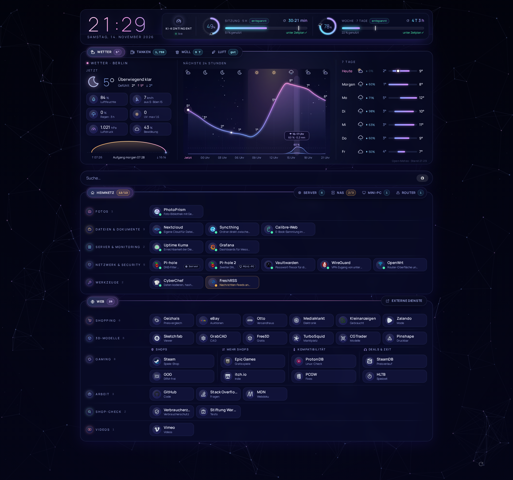
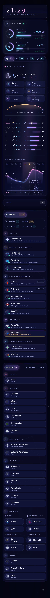
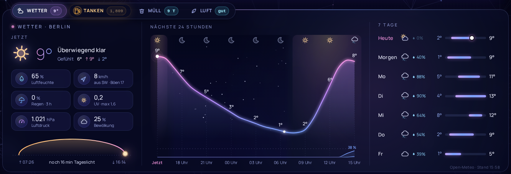
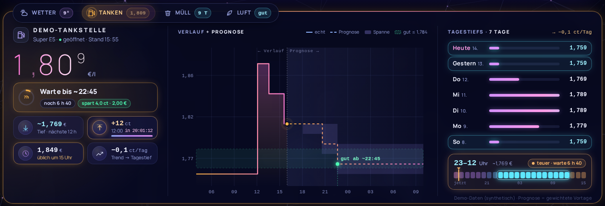
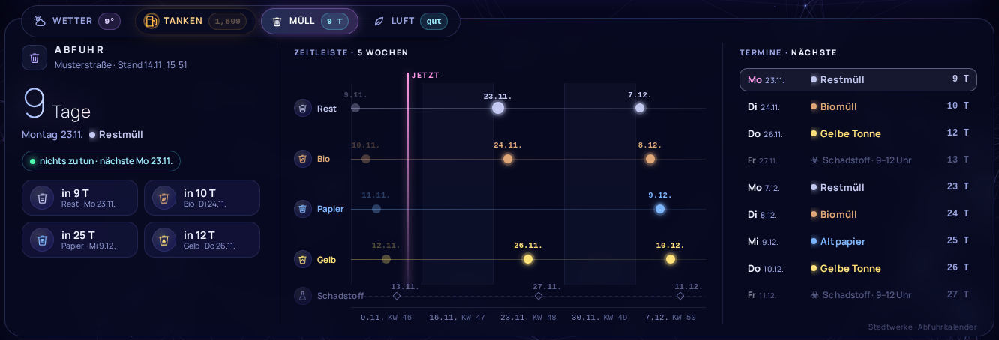
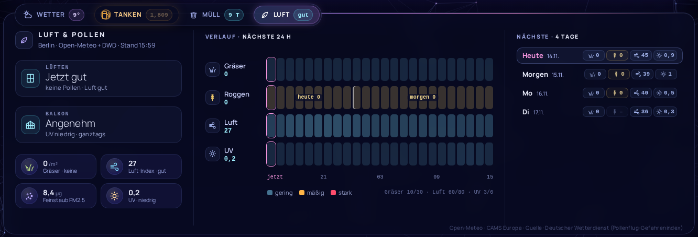
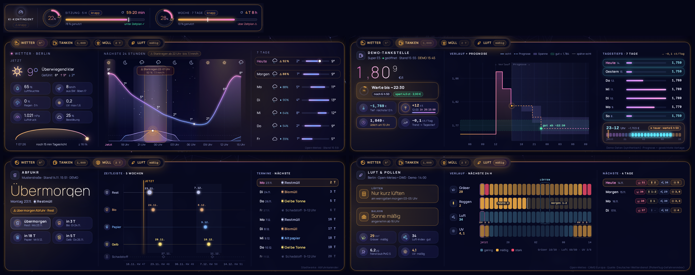
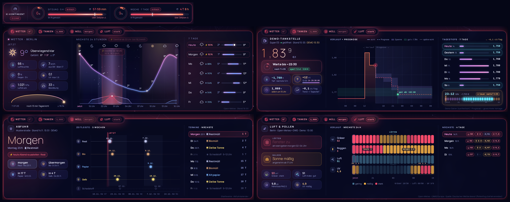
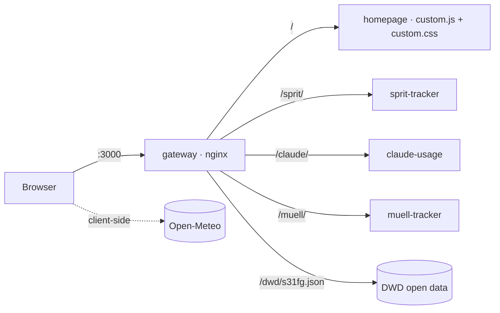

# Homelab Command Deck

A custom dashboard on [gethomepage](https://gethomepage.dev) with weather, fuel-price, waste-collection, air-quality and AI-usage panels – Docker Compose, nginx gateway, Python sidecars.

It extends stock Homepage with an animated constellation background (theme "Nebula") and glass panels, all injected through plain `custom.js` / `custom.css`.

> [!NOTE]
> **All data in this repository and in the screenshots is example (mock) data.** Location (Berlin), addresses, services, hosts/IPs, bookmarks, fuel prices, waste dates, air-quality and AI-usage numbers are made up or generated for the demo. They are not the author's real setup, location or usage.

*Screenshots show the demo mode with mock data.*



| | |
|---|---|
|  |  |

> **Language:** UI texts and most code comments are German (no i18n layer); the documentation is English.
> **Demo data only:** place (Berlin), addresses (`10.0.0.x`), station and street are made up; the bookmarks are example links to public websites.

## Features

| Panel | What it does |
|---|---|
| **Weather deck** ([Open-Meteo](https://open-meteo.com)) | Current conditions, 24-hour chart with day/night shading, 7-day list, a day view per weekday, rain zones with labels, a severe-weather warning state (amber / red). |
| **Fuel** (sprit-tracker) | Price history of one station, low/high/average tiles, a weekday overview and a forecast of the cheapest hour of the day. |
| **Waste** (muell-tracker) | Timeline of the next pick-ups per bin, hazardous-waste dates, notice box, warning states the day before / on the day. |
| **Air** ([Open-Meteo](https://open-meteo.com) + [DWD](https://opendata.dwd.de)) | Grass-family pollen, air quality and UV, with a "ventilate now?" and an "is it pleasant to sit outside?" verdict (UV) and the best time window. |
| **AI plan usage** (claude-usage) | Shows the usage of an AI plan (e.g. Claude) as session and weekly rings with warning and critical states; the panel is titled "KI-Kontingent". Demo data only – see [sidecars/claude-usage/README.md](sidecars/claude-usage/README.md). |
| **Home-network and web decks** | Services (with reachability dots) and bookmarks as glass decks, a **host notch** per device (online count, hover highlights its tiles) and host tags for services that run on several hosts. |
| **Background** | Animated constellation net on a canvas that reacts to the cursor; reduced density and frame rate on phones. |
| **Mobile view** | Everything above has a dedicated ≤ 700 px layout. |

| Weather | Fuel | Waste | Air |
|---|---|---|---|
|  |  |  |  |

Warning and critical states (shared design for all panels; mock data):

| Warning | Critical |
|---|---|
|  |  |

## Architecture



- There is **no build pipeline**: `custom.js` and `custom.css` are loaded by Homepage and render everything in the browser.
- Data is fetched client-side from same-origin paths (`/sprit/…`, `/claude/…`, `/muell/…`, `/dwd/…`); the **gateway** (nginx) makes them one origin and hides the sidecars.
- Open-Meteo is called directly from the browser (CORS enabled).
- The three sidecars are small Python-standard-library services. `sprit-tracker` and `muell-tracker` have a `DEMO=1` mode next to their real mode; `claude-usage` is demo-only: a demo data source for a panel that shows the usage of an AI subscription such as Claude – synthetic numbers only, it does not connect to any Anthropic service.

More in [docs/architecture.md](docs/architecture.md).

## Quick start

```bash
git clone https://github.com/MarcelJanAdamski/homelab-command-deck.git && cd homelab-command-deck
cp .env.example .env
docker compose up -d --build
```

Open <http://localhost:3000>. With `DEMO=1` (default) every panel is filled without keys. Weather and pollen need internet access.

`DEMO` is global for `sprit-tracker` and `muell-tracker`: `DEMO=0` in `.env` switches both to real sources at once, and then each needs its keys/URLs (Tankerkönig key and station, calendar URL – see `.env.example`). `claude-usage` has no real mode and always serves demo data.

`HOMEPAGE_ALLOWED_HOSTS` must contain the host and port you type into the browser, otherwise Homepage answers "host not allowed". The default is `localhost:${PORT}`; to open the dashboard from another machine, set it in `.env`, e.g. `HOMEPAGE_ALLOWED_HOSTS=localhost:3000,10.0.0.20:3000` (comma-separated, no spaces).

## Configuration

All location- and owner-specific values sit in a few marked places (details: [docs/configuration.md](docs/configuration.md)):

- `homepage/config/custom.js` – block between `/* KONFIG-START */` and `/* KONFIG-ENDE */`: place and coordinates, DWD pollen region, waste labels, hosts for the host notch, domain suffix.
- `homepage/config/custom.css` – block between the same markers: column titles of the four-column bookmark group.
- `homepage/config/*.yaml` – services, bookmarks, widgets, settings (the group **icons** in `settings.yaml` position the groups, see the docs).
- `.env` – sidecar settings; `DEMO=0` plus keys for real operation.

Demo states for every panel can be forced with URL hashes, e.g. `http://localhost:3000/#tkdemo=crit`:

| Hash | Values |
|---|---|
| `#wxdemo=` | `warn`, `crit` |
| `#tkdemo=` | `warn`, `crit`, `jump`, `ok` |
| `#mudemo=` | `warn`, `crit`, `note`, `plan`, `upd`, `updcrit` |
| `#ludemo=` | `warn`, `crit` |
| `#cldemo=` | `warn`, `crit` |

Live editing: copy `compose.override.example.yaml` to `compose.override.yaml` (mounts `homepage/config`) and start with `docker compose up -d --build` – Compose picks the override up automatically.

## Tests

Each sidecar has unit tests (standard library, no network):

```bash
cd sidecars/sprit-tracker && python3 -W error::ResourceWarning -m unittest discover -s tests -t . -v
cd sidecars/claude-usage  && python3 -W error::ResourceWarning -m unittest discover -s tests -v
cd sidecars/muell-tracker && python3 -W error::ResourceWarning -m unittest discover -s tests -v
```

## How this was built

The idea, the requirements, the design decisions (made by choosing between mock-up variants), the operation (a small home server running Docker) and the acceptance are Marcel Adamski's. The implementation was done together with an **AI coding agent running on Claude (Anthropic)** – the code was written by the agent, not by hand. Claude is used here only as a development tool; see [Trademarks & affiliation](#trademarks--affiliation).

Time invested in the dashboard with the agent: roughly **40–55 hours of active work** in about 95 sessions on 29 days (September–November 2026). This is an estimate from the session timestamps, with breaks and unrelated sessions removed.

## Third-party data & licences

This project only *uses* the services and assets below; their data and files are not part of the repository (except what the demo bakes in as made-up values). Check the terms before you run it publicly. Bundled third-party code (inline icons) and the full list of referenced sources: [THIRD-PARTY-NOTICES.md](THIRD-PARTY-NOTICES.md).

| What | Used for | Licence / terms |
|---|---|---|
| [Open-Meteo](https://open-meteo.com/en/license) | weather forecast and air-quality data, fetched by the browser | CC BY 4.0 – attribution link shown next to the data. The free API is for **non-commercial use only** (fewer than 10,000 calls per day, see the [Open-Meteo terms](https://open-meteo.com/en/terms)); commercial use needs a paid plan |
| [CAMS](https://atmosphere.copernicus.eu) (Copernicus Atmosphere Monitoring Service) | air quality and grass-pollen model data, delivered via the [Open-Meteo air-quality API](https://open-meteo.com/en/docs/air-quality-api) | Copernicus licence; attribution through Open-Meteo |
| [DWD Pollenflug-Gefahrenindex](https://www.dwd.de/DE/leistungen/gefahrenindizespollen/gefahrenindexpollen.html) ([`s31fg.json`](https://opendata.dwd.de/climate_environment/health/alerts/s31fg.json)) | rye pollen index shown as an extra lane in the Air tab | CC BY 4.0, source note "Quelle: Deutscher Wetterdienst"; see the [DWD legal notes](https://www.dwd.de/DE/service/rechtliche_hinweise/rechtliche_hinweise_node.html) |
| [Tankerkönig](https://creativecommons.tankerkoenig.de) (MTS-K data) | fuel prices in real operation (`DEMO=0`; demo mode shows synthetic prices) | [CC BY 4.0](https://creativecommons.org/licenses/by/4.0/) – "Tankerkönig / MTS-K"; needs your own API key; poll no more often than every 5 minutes; do not redistribute the data or expose `/sprit/` publicly; see the [terms](https://onboarding.tankerkoenig.de/geschaeftsbedingungen). The demo shows synthetic prices and labels them as such ("Demo-Daten (synthetisch)") |
| Waste calendar (`ICS_URL`, `NOTICE_URL`) | iCal feed and optional notice page of your waste authority in real operation (`DEMO=0`); demo mode uses made-up dates | Respect your provider's terms when using `ICS_URL` / `NOTICE_URL`. |
| [Homepage](https://github.com/gethomepage/homepage) | the dashboard itself | [GPL-3.0](https://github.com/gethomepage/homepage/blob/main/LICENSE); runs as its own container (`ghcr.io/gethomepage/homepage`), its code is not shipped here. Do not redistribute a built image without complying with GPL-3.0. |
| [Material Design Icons](https://pictogrammers.com/library/mdi/) (`mdi-…`), [Simple Icons](https://simpleicons.org) (`si-…`), [dashboard-icons](https://github.com/homarr-labs/dashboard-icons) | service and bookmark icons | Apache 2.0 ([MDI](https://github.com/Templarian/MaterialDesign/blob/master/LICENSE)), CC0 ([Simple Icons](https://github.com/simple-icons/simple-icons/blob/develop/LICENSE.md)), Apache 2.0 ([dashboard-icons](https://github.com/homarr-labs/dashboard-icons/blob/main/LICENSE)) – referenced by name, loaded at runtime, not copied. Brand names and logos belong to their owners. |
| AI plan usage | the `claude-usage` sidecar | Demo data only (see [sidecars/claude-usage/README.md](sidecars/claude-usage/README.md)). No Anthropic service or sign-in is used. |

## Trademarks & affiliation

Not affiliated with or endorsed by the Homepage project (gethomepage), Anthropic, or any other service shown. Claude is a trademark of Anthropic, PBC. All other product names, logos and brands are property of their respective owners and are used for identification only.

## Privacy

This repository contains example (mock) data only: no real location, addresses, keys or accounts. The values in `.env.example` and the KONFIG blocks are placeholders.

## License

[MIT](LICENSE) © 2026 Marcel Adamski
