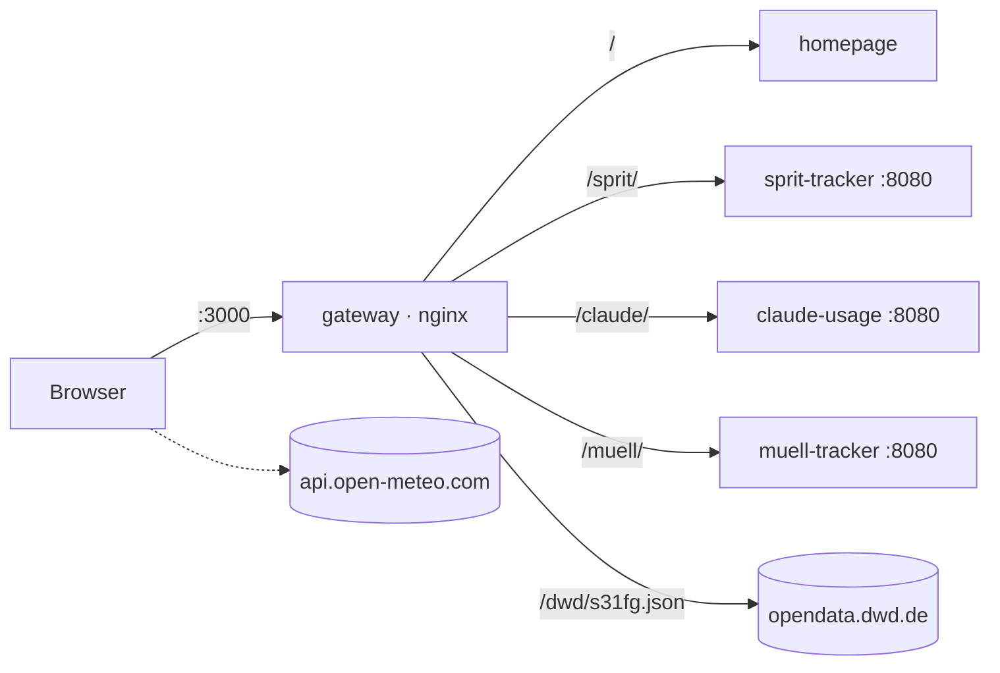

# Architecture

## Containers

| Service | Image | Role |
|---|---|---|
| `gateway` | `nginx:1.27-alpine` | The only published port (`${PORT:-3000}`). Proxies `/` to Homepage, `/sprit/`, `/claude/`, `/muell/` to the sidecars (prefix stripped) and `/dwd/s31fg.json` to the DWD open-data server. |
| `homepage` | `ghcr.io/gethomepage/homepage:v2.7.0` + `COPY config/` | Stock Homepage; the configuration (YAML, `custom.css`, `custom.js`) is baked into the image. |
| `sprit-tracker` | `python:3.12-alpine` | Fuel prices, SQLite in a named volume. |
| `claude-usage` | `python:3.12-alpine` | Demo data source for a panel that shows the usage of an AI subscription such as Claude. Synthetic numbers only; it does not connect to any Anthropic service. |
| `muell-tracker` | `python:3.12-alpine` | Waste-collection calendar. |

No bind mounts with host paths: configuration and code are copied into the images, so the stack also works as a Git-based stack in tools that do not support relative mounts. `compose.override.example.yaml` shows the optional live-editing mount of `homepage/config`.

## Gateway details

- Upstreams are resolved per request through Docker's DNS (`resolver 127.0.0.11`) and set through variables, so nginx starts even when a sidecar is not running yet; its path then answers 502 and the panel shows its error state.
- The `Host` header of the browser is passed on unchanged, which is what `HOMEPAGE_ALLOWED_HOSTS` checks.
- The DWD file is fetched over HTTPS (SNI on) and cached for 30 minutes; DWD sends no CORS headers, hence the proxy.

## Front end

- Homepage injects `custom.css` (render-blocking `<link>`) and `custom.js` (after interactive). There is no build step, no framework and no bundler.
- `custom.js` consists of independent blocks (IIFEs, each with a "run once" flag): background canvas, weather deck, fuel tab, waste tab, air tab, AI-plan usage panel, decks (heads, counters), host notch, category icons, mobile performance. Each block reads its settings through `cfg("path", fallback)` from the `window.GX_CFG` object defined in the KONFIG block, so a missing value never breaks a panel.
- Panels are tabs in one deck (`#gx-tabs`); the active tab is mirrored to `html[data-gx-tab]`, which CSS uses to show or hide panels.
- Data is fetched in the browser and cached in `localStorage`, so a reload shows data immediately.
- Demo states can be forced with URL hashes (append to the dashboard URL, e.g. `http://localhost:3000/#tkdemo=crit`):

  | Hash | Values | Panel |
  |---|---|---|
  | `#wxdemo=` | `warn`, `crit` | Weather: severe-weather warning (amber / red) |
  | `#tkdemo=` | `warn`, `crit`, `jump`, `ok` | Fuel: price-level states and the "price jump soon" hint |
  | `#mudemo=` | `warn`, `crit`, `note`, `plan`, `upd`, `updcrit` | Waste: pick-up warnings, notice box, hazardous-waste plan hint / "plan needs updating" (normal / critical) |
  | `#ludemo=` | `warn`, `crit` | Air: pollen / UV load |
  | `#cldemo=` | `warn`, `crit` | AI plan usage: warning and critical rings |

## Group placement

`custom.css` places every service and bookmark group by the **icon** configured for it in `settings.yaml` (`layout.<group>.icon`), not by its name or links. Changing an icon requires changing the matching selector in `custom.css`.
